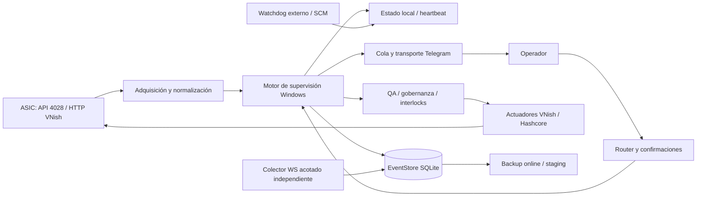

# Diseño del sistema

> Tipo: arquitectura vigente · Revisión: 2026-11-16 · Contraste estático con el código.

## Procesos y fronteras



El monitor es el proceso nativo de larga vida. Los colectores y jobs auxiliares no
son nuevos controladores de potencia. Telegram es una superficie de operación con
confirmaciones y permisos; los dashboards de diagnóstico consumen evidencia.

## Componentes del repositorio

| Componente | Responsabilidad |
|---|---|
| [app/miner_monitor.py](../../app/miner_monitor.py) | Punto de entrada y fachada de compatibilidad |
| [app/core/engine.py](../../app/core/engine.py) | Motor, etapas, detección, actuación y contención de hooks |
| [app/core/pipeline.py](../../app/core/pipeline.py) | Adquisición y hooks de integración del ciclo |
| [app/core/context.py](../../app/core/context.py) | Contexto de dependencias del monitor |
| [app/core/models.py](../../app/core/models.py) | MinerState y estado operativo por equipo |
| [app/core/state_manager.py](../../app/core/state_manager.py) | Carga y persistencia de continuidad |
| [app/core/event_store.py](../../app/core/event_store.py) | EventStore SQLite, esquema 7 y registros durables |
| [app/core/restart_intelligence.py](../../app/core/restart_intelligence.py) | Clasificación y seguridad de recuperaciónL1/watchdog de presets |
| [app/governance/](../../app/governance) | Políticas térmicas, ventilación, potencia e intervenciones |
| [app/network/](../../app/network) | Transporte API 4028 |
| [app/vnish/](../../app/vnish) | ClienteHTTP, telemetría y colección de firmware |
| [app/telegram/](../../app/telegram) | Router, handlers, callbacks, ayuda y entrega |
| [app/backup/health.py](../../app/backup/health.py) | Contrato de salud del respaldo para las vistas |
| [tools/](../../tools) | Herramientas y procesos auxiliares explícitos |

## Pipeline

El orden definido por HookStage es:

```text
PRE_TICK → ACQUISITION → DETECTION → GOVERNANCE → ACTUATOR → PERSISTENCE → POST_TICK
```

El motor transmite resultados mediante tick_data y registra errores por hook. Las
etapas de persistencia y cierre se intentan aun cuando otra etapa falle. Esta
contención no convierte una muestra ausente en saludable ni prueba que todas las
acciones hayan concluido correctamente.

## Concurrencia y datos

- Polling de Telegram, envío y ciertos trabajos auxiliares operan fuera del hilo
  del ciclo. Las escrituras de estado compartido usan los locks del contexto.
- Las lecturasHTTP de seguridad introducidas por 096 quedan fuera de state_lock.
  Los workers revalidan permisos antes de ejecutar un restart.
- SQLite conserva telemetría, eventos y decisiones; sus consultas históricas no son
  un disparador autónomo de reboot. El backup tiene conexiones propias y proceso separado.
- state.json conserva continuidad; heartbeat describe vida del monitor. No son una
  copia de seguridad equivalente a EventStore ni un reemplazo de la muestra actual.
- La colaTelegram permite desacoplar entrega y supervisión. Dedupe y reintentos acotados
  no garantizan exactamente una entrega cuando se pierde una respuesta.

## Evidencia y actuación

Una señal 4028 y un estado nativo cumplen papeles distintos. El estado nativo fresco
permite reconocer autotune y flags pendientes antes de una intervención. La falta de
respuestaHTTP no autoriza una recuperaciónL1 basada en una suposición de mining.
Los interlocks y tiempos sostenidos de L2 conservan su contrato propio.

No atribuir fallasAC a partir de voltajes DC, ni un reboot observado a una intención
sin evidencia de envío exitoso. Los límites y los resultados medidos se documentan en
[operación](../operations/README.md), no como una garantía universal de la arquitectura.
