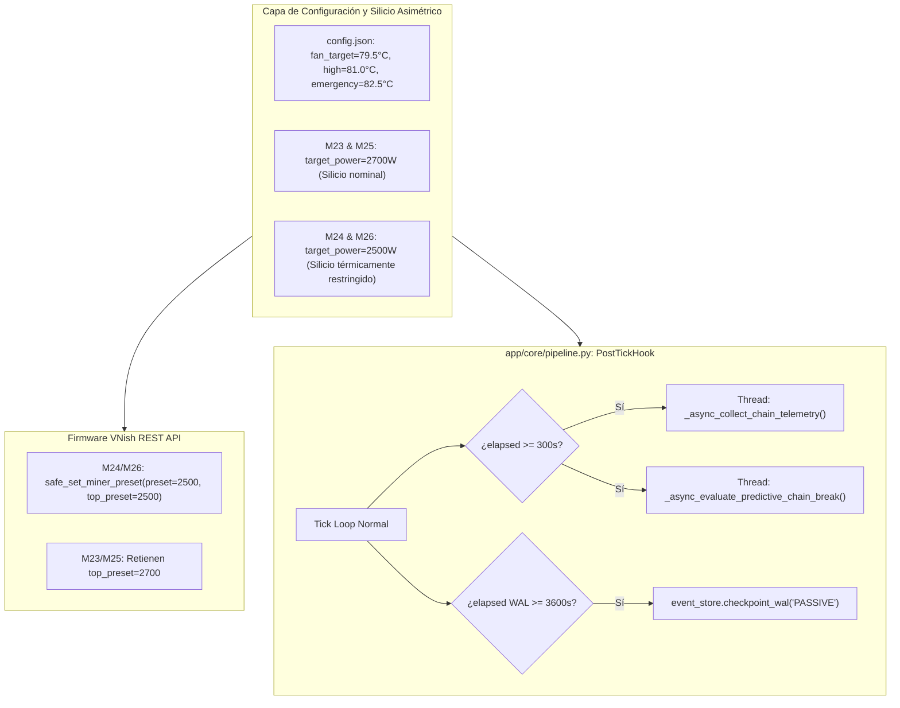

# Implementation Plan: Armonización Térmica y Estabilidad VNish (Spec 092)

**Feature**: `092-vnish-harmonization-and-stability`
**Dependencies**: Arquitectura V6.0 (`specs/091-core-daemon-hookification`)
**Target Outcome**: Estabilidad operativa continua de M24 y M26 a 2500W, M23 y M25 a 2700W, Fan Governor armonizado a 79.5°C con headroom de 3°C, y telemetría de cadenas periódica restaurada en SQLite.

---

## 1. Technical Architecture & Component Interaction

---

## 2. Step-by-Step Implementation Sequence

### Paso 1: Configuración de Parámetros del Fan Governor
- Modificar en `app/config.json` y `app/config.example.json`:
  - `fan_governor_target_temp_c`: `79.5`
  - `fan_governor_deadband_low_c`: `78.0`
  - `fan_governor_deadband_high_c`: `81.0`
  - `fan_governor_emergency_temp_c`: `82.5`
- Configurar por minero:
  - M24 y M26: `target_power_w: 2500.0`, `max_hardware_preset: "2500W"`.
  - M23 y M25: `target_power_w: 2700.0`, `max_hardware_preset: "2700W"`.

### Paso 2: Clampeo en Caliente del Firmware VNish en M24 y M26
- Ejecutar llamada de API segura para reconfigurar `top_preset: "2500"` y preset inicial `"2500"` en `192.168.100.24` y `192.168.100.26`.
- Verificar que `/api/v1/settings` en ambos mineros devuelva `top_preset: "2500"` y `restart_required: false`.

### Paso 3: Conexión de Telemetría Periódica en `PostTickHook`
- En `app/core/pipeline.py`:
  - Agregar tracking estático `_last_chain_telemetry_ts`, `_last_predictive_chain_eval_ts`, `_last_wal_passive_ts`, `_last_wal_truncate_date`.
  - Conectar en `PostTickHook.execute()`:
    1. Si `(now_ts - _last_chain_telemetry_ts) >= chain_telemetry_interval_s`: despachar `_async_collect_chain_telemetry` en hilo daemon.
    2. Si `(now_ts - _last_predictive_chain_eval_ts) >= predictive_chain_eval_interval_s`: despachar `_async_evaluate_predictive_chain_break` en hilo daemon.
    3. Si `(now_ts - _last_wal_passive_ts) >= 3600.0`: ejecutar `event_store.checkpoint_wal("PASSIVE")`.
    4. Si hora UTC entre 3 y 5: ejecutar `event_store.checkpoint_wal("TRUNCATE")`.

### Paso 4: Verificación de Código y Suite de Pruebas
- Verificar compilación sintáctica con `py_compile`.
- Ejecutar suite de pruebas completa `pytest tests/` asegurando $\ge 1530$ tests PASS.

### Paso 5: QA y Estabilización de Release
- Ejecutar `.agents/skills/speckit-qa/scripts/preflight.ps1`.
- Reiniciar el servicio NSSM `MinerAlerts` y verificar logs en vivo.
- Ejecutar `.agents/skills/speckit-stabilize/scripts/preflight_stabilize.ps1`.
- Actualizar `docs/audit/DEVELOPMENT_LOG.md` y `prompt.txt`.
- Realizar commit y push limpio.

---

## 3. Verification & Quality Gates

1. **Sintaxis**: `py_compile` en todos los archivos modificados.
2. **Determinismo de Pruebas**: $\ge 1530$ tests PASS, 0 fallos.
3. **Comprobación en Vivo**:
   - M24 y M26 operando a 2500W con temperaturas entre 72°C y 76°C.
   - M23 y M25 operando a 2700W con temperaturas entre 77°C y 80°C.
   - 0 reinicios por `HASHBOARD` o caída de Cadena 1.
   - Nuevos registros ingresando periódicamente en `chain_telemetry_samples` de SQLite.
